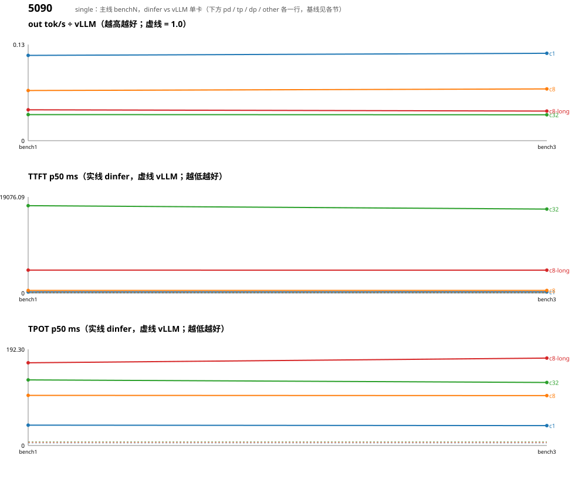

# Qwen3-0.6B 性能趋势（dinfer vs vLLM v0.31.0，`bench_compare.sh` 四组；按卡型分节：5090）

每轮一行；括号内是相对上一轮的变化（吞吐 ↑ 为好，TTFT/TPOT ↓ 为好）。比值 = dinfer out tok/s ÷ vLLM（无 vLLM 基线的卡为 —）。vLLM 各轮自己也有 ±3% 抖动。

# 5090

## single

基线 = vLLM v0.31.0 单卡（同机同配置）。

| 轮 | 日期 | 改动 | c1 tok/s (×vLLM) | c8 tok/s (×vLLM) | c32 tok/s (×vLLM) | c8-long tok/s (×vLLM) | c1 TTFT ms | c8 TTFT ms | c32 TTFT ms | c8-long TTFT ms | c1 TPOT ms | c8 TPOT ms | c32 TPOT ms | c8-long TPOT ms |
|---|---|---|---|---|---|---|---|---|---|---|---|---|---|---|
| bench1 | 2026-10-26 | R1 基线: R27 的 mega(gate/up 并行,1.66x kernel),dense MLP persistent,无 split-K | 24 (0.11×) | 80 (0.07×) | 125 (0.03×) | 40 (0.04×) | 226.5 / 18.8 | 518.7 / 89.9 | 17341.9 / 173.2 | 4560.5 / 225.2 | 40.72 / 4.67 | 100.29 / 6.01 | 131.25 / 7.56 | 165.44 / 6.54 |
| bench3 | 2026-10-26 | R3 split-K sp_gu=4/sp_dn=4/ctas=1: gate/up+down 都切 K,kernel 2.05x(B=1),逐位一致 0/2816 | 24 (0.12×) (+2%) | 83 (0.07×) (+3%) | 124 (0.03×) (-0%) | 39 (0.04×) (-3%) | 227.0 / 19.1 (-0%) | 517.9 / 89.5 (+0%) | 16669.7 / 171.1 (+4%) | 4544.2 / 227.3 (+0%) | 39.71 / 4.67 (+2%) | 99.78 / 5.99 (+1%) | 126.00 / 7.55 (+4%) | 174.82 / 6.47 (-6%) |

### 首轮 → 最新

| 组 | out tok/s | ×vLLM | TTFT ms | TPOT ms |
|---|---|---|---|---|
| c1 | 24 → 24 (+2%) | 0.11 → 0.12 | 226.5 → 227.0 (-0%) | 40.72 → 39.71 (+2%) |
| c8 | 80 → 83 (+3%) | 0.07 → 0.07 | 518.7 → 517.9 (+0%) | 100.29 → 99.78 (+1%) |
| c32 | 125 → 124 (-0%) | 0.03 → 0.03 | 17341.9 → 16669.7 (+4%) | 131.25 → 126.00 (+4%) |
| c8-long | 40 → 39 (-3%) | 0.04 → 0.04 | 4560.5 → 4544.2 (+0%) | 165.44 → 174.82 (-6%) |

