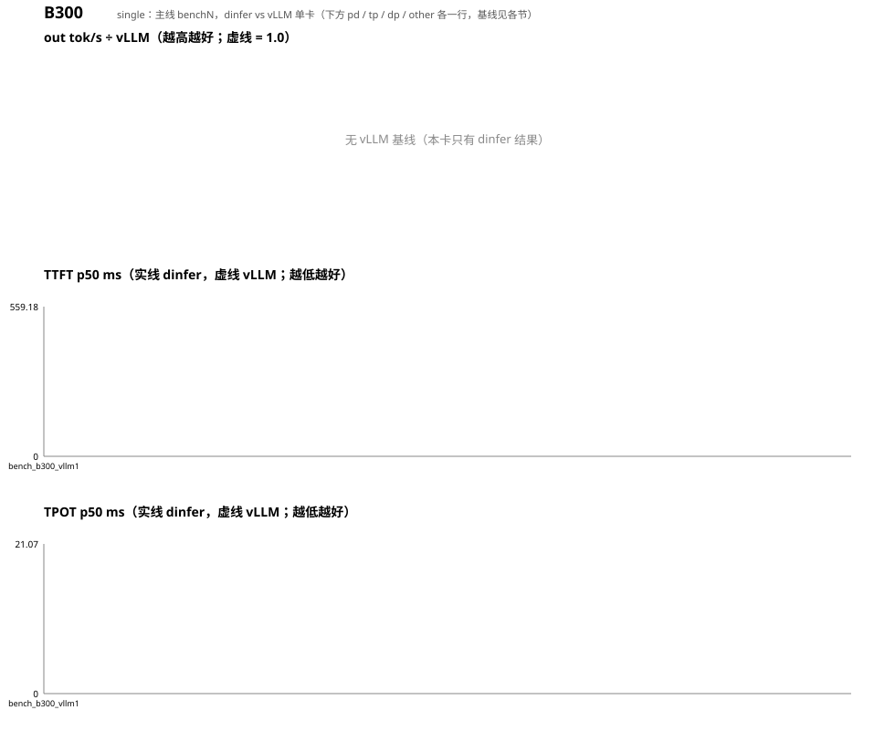

# Qwen3-0.6B 性能趋势（dinfer vs vLLM v0.31.0，`bench_compare.sh` 四组；按卡型分节：B300）

每轮一行；括号内是相对上一轮的变化（吞吐 ↑ 为好，TTFT/TPOT ↓ 为好）。比值 = dinfer out tok/s ÷ vLLM（无 vLLM 基线的卡为 —）。vLLM 各轮自己也有 ±3% 抖动。

# B300

## single

基线 = vLLM v0.31.0 单卡（同机同配置）。

| 轮 | 日期 | 改动 | c1 tok/s (×vLLM) | c8 tok/s (×vLLM) | c32 tok/s (×vLLM) | c8-long tok/s (×vLLM) | c1 TTFT ms | c8 TTFT ms | c32 TTFT ms | c8-long TTFT ms | c1 TPOT ms | c8 TPOT ms | c32 TPOT ms | c8-long TPOT ms |
|---|---|---|---|---|---|---|---|---|---|---|---|---|---|---|
| bench_b300_vllm1 | 2026-10-19 | vLLM nightly Kimi-K3 MXFP4 tp8 基线 | — (—×) | — (—×) | — (—×) | — (—×) | — / 192.6 | — / 368.4 | — / 420.6 | — / 508.3 | — / 8.70 | — / 13.09 | — / 19.15 | — / 13.11 |

### 首轮 → 最新

| 组 | out tok/s | ×vLLM | TTFT ms | TPOT ms |
|---|---|---|---|---|
| c1 | nan → nan (—) | — → — | nan → nan (—) | nan → nan (—) |
| c8 | nan → nan (—) | — → — | nan → nan (—) | nan → nan (—) |
| c32 | nan → nan (—) | — → — | nan → nan (—) | nan → nan (—) |
| c8-long | nan → nan (—) | — → — | nan → nan (—) | nan → nan (—) |

