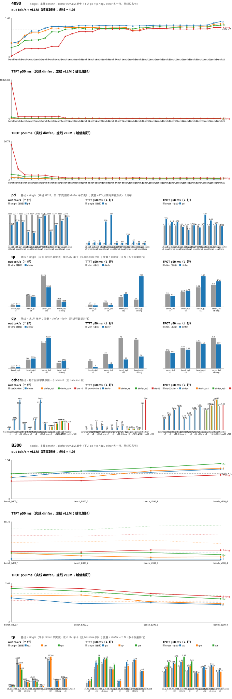

# Qwen3-0.6B 性能趋势（dinfer vs vLLM v0.31.0，4090，`bench_compare.sh` 四组）

每轮一行；括号内是相对上一轮的变化（吞吐 ↑ 为好，TTFT/TPOT ↓ 为好）。比值 = dinfer out tok/s ÷ vLLM。vLLM 各轮自己也有 ±3% 抖动。

| 轮 | 日期 | 改动 | c1 tok/s (×vLLM) | c8 tok/s (×vLLM) | c32 tok/s (×vLLM) | c8-long tok/s (×vLLM) | c1 TTFT ms | c8 TTFT ms | c32 TTFT ms | c8-long TTFT ms | c1 TPOT ms | c8 TPOT ms | c32 TPOT ms | c8-long TPOT ms |
|---|---|---|---|---|---|---|---|---|---|---|---|---|---|---|
| bench | 2026-10-16 | bench 基线：参考 kernel（prefill 逐行三遍扫、decode 单 warp），debug 构建 | 221 (0.49×) | 1465 (0.50×) | 2707 (0.34×) | 56 (0.03×) | 83.7 / 17.5 | 85.6 / 28.6 | 375.6 / 68.7 | 9368.9 / 55.1 | 3.91 / 2.12 | 4.57 / 2.54 | 10.04 / 3.40 | 60.72 / 3.74 |
| bench3 | 2026-10-16 | a prefill attention：flash tile kernel（prefill + paged）；release 构建 | 244 (0.54×) (+11%) | 1458 (0.50×) (-1%) | 3481 (0.41×) (+29%) | 347 (0.17×) (+519%) | 43.7 / 11.9 (+48%) | 41.8 / 24.6 (+51%) | 92.0 / 63.9 (+76%) | 495.0 / 35.6 (+95%) | 3.78 / 2.12 (+3%) | 5.25 / 2.54 (-15%) | 8.70 / 3.25 (+13%) | 19.34 / 3.54 (+68%) |
| bench4 | 2026-10-16 | b decode attention：split-K kernel | 327 (0.72×) (+34%) | 2283 (0.78×) (+57%) | 5048 (0.59×) (+45%) | 615 (0.29×) (+77%) | 43.2 / 11.4 (+1%) | 43.8 / 25.1 (-5%) | 98.7 / 65.1 (-7%) | 496.9 / 36.4 (-0%) | 2.74 / 2.12 (+28%) | 3.24 / 2.54 (+38%) | 5.78 / 3.25 (+34%) | 9.17 / 3.54 (+53%) |
| bench5 | 2026-10-16 | c CUDA graph：固定地址缓冲 + decode 按桶捕获（forward+采样图内） | 423 (0.93×) (+29%) | 2548 (0.87×) (+12%) | 5166 (0.60×) (+2%) | 630 (0.30×) (+2%) | 43.4 / 11.7 (-0%) | 42.7 / 25.7 (+2%) | 92.4 / 60.5 (+6%) | 497.5 / 36.0 (-0%) | 2.05 / 2.12 (+25%) | 2.91 / 2.54 (+10%) | 5.69 / 3.25 (+2%) | 8.83 / 3.54 (+4%) |
| bench6 | 2026-10-16 | d TCP_NODELAY（Nagle 导致 TTFT +38 ms） | 423 (0.93×) (-0%) | 2542 (0.86×) (-0%) | 5165 (0.61×) (-0%) | 630 (0.30×) (-0%) | 6.5 / 12.4 (+85%) | 12.5 / 24.8 (+71%) | 92.1 / 65.4 (+0%) | 492.5 / 37.2 (+1%) | 2.33 / 2.12 (-14%) | 3.00 / 2.53 (-3%) | 5.69 / 3.25 (+0%) | 8.88 / 3.54 (-1%) |
| bench7 | 2026-10-16 | e kernel 融合：qkv_post（norm+rope+cache write 一个 kernel）、attention 按 stride 读 qkv_buf（去 copy_cols）、MLP 残差并入下一层 norm；17→8 kernel/层 | 471 (1.04×) (+11%) | 2755 (0.94×) (+8%) | 5788 (0.68×) (+12%) | 645 (0.31×) (+2%) | 6.0 / 12.3 (+8%) | 11.5 / 26.6 (+8%) | 88.2 / 62.7 (+4%) | 489.3 / 38.3 (+1%) | 2.10 / 2.10 (+10%) | 2.80 / 2.50 (+7%) | 5.00 / 3.30 (+12%) | 8.60 / 3.50 (+3%) |
| bench8 | 2026-10-16 | e 续：decode attention v2（8 lane/key、uint4 向量读 K/V、4 key/warp、两 q head 共享 K 读、splits 自适应） | 499 (1.09×) (+6%) | 3022 (1.04×) (+10%) | 7659 (0.90×) (+32%) | 795 (0.38×) (+23%) | 5.9 / 11.2 (+2%) | 11.8 / 28.2 (-3%) | 88.6 / 67.5 (-0%) | 488.3 / 35.4 (+0%) | 1.97 / 2.12 (+6%) | 2.50 / 2.54 (+11%) | 3.68 / 3.27 (+26%) | 6.25 / 3.55 (+27%) |
| bench9 | 2026-10-16 | e 续：decode splits==1 时跳过 merge kernel（B≥32 少 28 launch/step）；面板加点击轮次详情 | 497 (1.09×) (-0%) | 3013 (1.03×) (-0%) | 7690 (0.89×) (+0%) | 795 (0.38×) (+0%) | 6.1 / 11.7 (-4%) | 12.1 / 26.5 (-3%) | 88.5 / 63.0 (+0%) | 592.9 / 35.5 (-21%) | 1.98 / 2.12 (-0%) | 2.51 / 2.54 (-0%) | 3.67 / 3.26 (+0%) | 5.41 / 3.54 (+13%) |
| bench10 | 2026-10-16 | e 续 3：prefill/paged attention v2（32 行/block 按 kv head 分块、两 q head 共享 K/V tile、uint4 装载）；3090 T=1514 9.6→2.6 ms/层 | 500 (1.10×) (+1%) | 3097 (1.05×) (+3%) | 8483 (0.99×) (+10%) | 1543 (0.74×) (+94%) | 4.8 / 12.1 (+21%) | 9.4 / 25.6 (+22%) | 41.4 / 63.3 (+53%) | 127.0 / 35.6 (+79%) | 1.97 / 2.12 (+0%) | 2.51 / 2.53 (+0%) | 3.53 / 3.26 (+4%) | 4.18 / 3.55 (+23%) |
| bench11 | 2026-10-16 | e 续 4：prefill/paged attention v3 = WMMA bf16 tensor core（S=QKᵀ、O+=PV 走 mma；online softmax 在 smem）；3090 T=1514 2.6→1.34 ms/层 | 500 (1.10×) (-0%) | 3101 (1.05×) (+0%) | 8521 (1.00×) (+0%) | 1728 (0.83×) (+12%) | 4.7 / 11.8 (+3%) | 8.4 / 25.0 (+10%) | 38.6 / 66.6 (+7%) | 84.6 / 41.4 (+33%) | 1.98 / 2.12 (-0%) | 2.51 / 2.54 (-0%) | 3.54 / 3.26 (-0%) | 3.97 / 3.55 (+5%) |
| bench12 | 2026-10-16 | 口径修正：bench 每次运行换 seed（之前固定 seed 让常驻 vLLM prefix cache 90% 命中、dinfer 冷）；代码与 bench11 相同（prefill v3） | 499 (1.12×) (-0%) | 3095 (1.06×) (-0%) | 8524 (1.04×) (+0%) | 1727 (0.91×) (-0%) | 5.0 / 17.2 (-6%) | 9.5 / 28.4 (-13%) | 38.6 / 78.7 (-0%) | 84.6 / 68.0 (+0%) | 1.98 / 2.12 (-0%) | 2.51 / 2.54 (-0%) | 3.54 / 3.33 (-0%) | 3.97 / 3.74 (+0%) |
| bench13 | 2026-10-16 | f decode splits：decode_v2 splits 目标 256 → 1024 block（B=8 长序列 64 → 512 block；4090 B=8 seq=2048 0.040 → 0.032 ms） | 500 (1.12×) (+0%) | 3082 (1.06×) (-0%) | 8331 (1.00×) (-2%) | 1730 (0.91×) (+0%) | 4.7 / 17.5 (+5%) | 8.3 / 28.6 (+13%) | 38.7 / 74.6 (-0%) | 101.8 / 59.6 (-20%) | 1.98 / 2.12 (+0%) | 2.52 / 2.54 (-0%) | 3.63 / 3.30 (-2%) | 3.87 / 3.74 (+2%) |
| bench14 | 2026-10-16 | g 混批分流：Paged 步里 decode 行走 decode_v2（cu_seqlens_q 行映射）、prefill 行走 paged_tc（跳过 q_len==1）；3090 微基准 C 形状 0.86→0.76 ms、D 0.32→0.07 | 499 (1.11×) (-0%) | 3075 (1.05×) (-0%) | 8323 (1.00×) (-0%) | 1729 (0.90×) (-0%) | 4.7 / 16.8 (+1%) | 8.7 / 28.2 (-6%) | 38.7 / 75.0 (-0%) | 100.8 / 54.4 (+1%) | 1.98 / 2.12 (-0%) | 2.53 / 2.53 (-0%) | 3.63 / 3.30 (-0%) | 3.86 / 3.75 (+0%) |
| bench15 | 2026-10-16 | h prefill/paged attention v4：FA2 结构（裸 mma.sync m16n8k16 + ldmatrix，S/P/O 全寄存器，64-key tile，34 KB smem 2 block/SM）；3090 T=1514 1.34→0.28 ms/层 | 501 (1.12×) (+1%) | 3093 (1.07×) (+1%) | 8444 (1.02×) (+1%) | 1915 (1.00×) (+11%) | 3.9 / 17.6 (+15%) | 7.2 / 33.6 (+18%) | 33.5 / 74.9 (+14%) | 68.3 / 67.5 (+32%) | 1.98 / 2.12 (+0%) | 2.53 / 2.54 (-0%) | 3.61 / 3.32 (+1%) | 3.80 / 3.74 (+2%) |
| bench16 | 2026-10-16 | 参数对齐实验（无代码改动）：--max-num-batched-tokens 4096 → 2048（= vLLM 4090 实际值），减少单个 prefill step 对 decode 的打断 | 501 (1.12×) (-0%) | 3092 (1.07×) (-0%) | 8441 (1.02×) (-0%) | 1906 (1.00×) (-0%) | 4.1 / 18.4 (-3%) | 7.4 / 34.7 (-3%) | 19.9 / 75.7 (+40%) | 39.4 / 67.7 (+42%) | 1.98 / 2.12 (-0%) | 2.53 / 2.55 (+0%) | 3.63 / 3.31 (-0%) | 3.88 / 3.74 (-2%) |
| bench17 | 2026-10-17 | j 跨流并行：混批 step 拆成 decode 批（主流，CUDA graph）+ prefill 批（副流，eager），事件同步，两套激活 scratch | 500 (1.12×) (-0%) | 3081 (1.06×) (-0%) | 8388 (1.02×) (-1%) | 1911 (1.00×) (+0%) | 3.9 / 16.9 (+3%) | 8.2 / 34.5 (-10%) | 22.9 / 75.7 (-15%) | 39.4 / 55.4 (+0%) | 1.98 / 2.12 (-0%) | 2.53 / 2.54 (-0%) | 3.64 / 3.33 (-0%) | 3.88 / 3.76 (+0%) |
| bench19 | 2026-10-17 | j 续：调度 decode 免预算（每步装下全部 decode 行 + 预算内 prefill）+ 跨流并行（decode 批主流图 / prefill 批副流） | 501 (1.12×) (+0%) | 3082 (1.07×) (+0%) | 8361 (1.02×) (-0%) | 1913 (1.00×) (+0%) | 3.8 / 17.5 (+4%) | 8.5 / 27.1 (-3%) | 22.8 / 78.1 (+0%) | 39.3 / 60.6 (+0%) | 1.98 / 2.12 (+0%) | 2.53 / 2.54 (+0%) | 3.64 / 3.35 (-0%) | 3.87 / 3.74 (+0%) |
| bench20 | 2026-10-17 | 启动 loop 收尾后的回归（懒捕获图 + 权重直传 + KV uninit；运行期逻辑同 bench19） | 500 (1.12×) (-0%) | 3056 (1.06×) (-1%) | 8351 (1.01×) (-0%) | 1910 (1.00×) (-0%) | 3.9 / 17.3 (-4%) | 13.8 / 34.3 (-63%) | 22.4 / 76.9 (+2%) | 39.4 / 67.7 (-0%) | 1.98 / 2.12 (-0%) | 2.53 / 2.54 (-0%) | 3.63 / 3.32 (+0%) | 3.88 / 3.74 (-0%) |
| bench21 | 2026-10-17 | k host 路径：每 step 输入打包进 pinned 缓冲，一次异步 H2D + D2D 散开（原 14 次同步 pageable memcpy ≈ 650 µs/步） | 495 (1.11×) (-1%) | 2728 (0.94×) (-11%) | 8383 (1.00×) (+0%) | 1773 (0.93×) (-7%) | 3.9 / 16.9 (-0%) | 13.8 / 34.2 (+0%) | 22.2 / 67.8 (+1%) | 39.4 / 68.0 (+0%) | 2.01 / 2.12 (-1%) | 2.84 / 2.54 (-12%) | 3.65 / 3.33 (-0%) | 4.20 / 3.76 (-8%) |
| bench22 | 2026-10-17 | k host 路径：block_table 缓冲行跨度改为 max_model_len/block_size（原用 KV 池总块数 9972 → 每步 1.3 MB 零填充 + H2D） | 499 (1.12×) (+1%) | 2804 (0.97×) (+3%) | 8650 (1.04×) (+3%) | 1792 (0.94×) (+1%) | 4.1 / 17.2 (-5%) | 9.9 / 35.7 (+28%) | 21.6 / 73.8 (+3%) | 39.5 / 61.7 (-0%) | 1.99 / 2.12 (+1%) | 2.79 / 2.54 (+2%) | 3.51 / 3.31 (+4%) | 4.16 / 3.76 (+1%) |
| bench23 | 2026-10-17 | 干净重启（restart_dinfer.sh；之前 :8012 是 20 h 前的孤儿旧进程）后的全量回归 = 新基线；代码含 block_table 跨度修复 | 501 (1.12×) (+0%) | 3078 (1.06×) (+10%) | 8690 (1.05×) (+0%) | 1922 (1.01×) (+7%) | 3.9 / 16.8 (+4%) | 13.8 / 33.9 (-39%) | 22.3 / 74.4 (-3%) | 39.4 / 60.1 (+0%) | 1.98 / 2.12 (+0%) | 2.51 / 2.54 (+10%) | 3.50 / 3.31 (+0%) | 3.83 / 3.76 (+8%) |
| bench24 | 2026-10-17 | l 异步调度：步 n 入队后不等 GPU 先调度并入队 n+1（设备侧 gather 上一步 chosen 作 input_ids，pinned 双槽异步 D2H）；host 开销藏进 GPU 时间 | 507 (1.13×) (+1%) | 3115 (1.08×) (+1%) | 8844 (1.08×) (+2%) | 1938 (1.01×) (+1%) | 3.9 / 17.3 (+2%) | 14.2 / 35.1 (-3%) | 22.7 / 77.8 (-2%) | 53.8 / 54.4 (-36%) | 1.95 / 2.12 (+1%) | 2.47 / 2.54 (+2%) | 3.43 / 3.33 (+2%) | 3.75 / 3.76 (+2%) |
| bench25 | 2026-10-17 | m 采样融合：temperature/min_p/topk-topp/sample 四 kernel → 一个（共用 row_* 原语，逐位同语义）；图内 -3 节点 | 509 (1.14×) (+0%) | 3143 (1.08×) (+1%) | 8818 (1.08×) (-0%) | 1946 (1.02×) (+0%) | 4.1 / 17.5 (-5%) | 13.5 / 29.1 (+5%) | 22.9 / 62.8 (-1%) | 51.5 / 60.9 (+4%) | 1.95 / 2.12 (+0%) | 2.46 / 2.54 (+0%) | 3.42 / 3.45 (+0%) | 3.73 / 3.75 (+0%) |
| bench26 | 2026-10-17 | n 小 kernel 融合：lm_head 前 gather_rows + 末层 rmsnorm → 一个 kernel（-1 launch/步） | 509 (1.14×) (+0%) | 3100 (1.07×) (-1%) | 8830 (1.07×) (+0%) | 1942 (1.01×) (-0%) | 4.0 / 17.3 (+1%) | 14.0 / 34.3 (-3%) | 22.9 / 76.1 (+0%) | 54.3 / 54.1 (-5%) | 1.95 / 2.12 (-0%) | 2.47 / 2.54 (-0%) | 3.41 / 3.34 (+0%) | 3.73 / 3.76 (+0%) |
| bench27 | 2026-10-17 | o 插队 prefill：在飞 decode 步未完成时，新请求立刻 schedule_waiting_only 并同步跑 prefill（不写 prev_chosen），首 token 提前一步 | 510 (1.14×) (+0%) | 3104 (1.07×) (+0%) | 8795 (1.06×) (-0%) | 1912 (1.00×) (-2%) | 3.9 / 17.5 (+4%) | 14.0 / 34.0 (+0%) | 36.2 / 73.6 (-58%) | 42.9 / 61.4 (+21%) | 1.95 / 2.12 (+0%) | 2.46 / 2.54 (+0%) | 3.41 / 3.32 (+0%) | 3.86 / 3.75 (-4%) |
| bench28 | 2026-10-17 | o 插队 prefill 修正：结果立刻回填再调度 n+1（修首 token 丢失）；负载门槛在飞 ≤8 行才插队 | 508 (1.14×) (-0%) | 3150 (1.09×) (+1%) | 8800 (1.07×) (+0%) | 1908 (1.00×) (-0%) | 4.1 / 17.6 (-5%) | 8.1 / 35.2 (+42%) | 23.2 / 73.2 (+36%) | 34.6 / 68.3 (+19%) | 1.95 / 2.12 (-0%) | 2.46 / 2.54 (-0%) | 3.43 / 3.32 (-0%) | 3.94 / 3.75 (-2%) |
| bench29 | 2026-10-17 | q OpSet：四组热路径算子进 trait（DefaultOps 零成本包装），模型泛型化；应与 bench28 零差异 | 509 (1.14×) (+0%) | 3106 (1.07×) (-1%) | 8815 (1.07×) (+0%) | 1911 (1.00×) (+0%) | 4.1 / 16.8 (-1%) | 14.1 / 27.4 (-73%) | 23.1 / 77.0 (+0%) | 34.3 / 54.2 (+1%) | 1.95 / 2.12 (+0%) | 2.46 / 2.54 (+0%) | 3.42 / 3.32 (+0%) | 3.93 / 3.75 (+0%) |

## 首轮 → 最新

| 组 | out tok/s | ×vLLM | TTFT ms | TPOT ms |
|---|---|---|---|---|
| c1 | 221 → 509 (+130%) | 0.49 → 1.14 | 83.7 → 4.1 (+95%) | 3.91 → 1.95 (+50%) |
| c8 | 1465 → 3106 (+112%) | 0.50 → 1.07 | 85.6 → 14.1 (+84%) | 4.57 → 2.46 (+46%) |
| c32 | 2707 → 8815 (+226%) | 0.34 → 1.07 | 375.6 → 23.1 (+94%) | 10.04 → 3.42 (+66%) |
| c8-long | 56 → 1911 (+3304%) | 0.03 → 1.00 | 9368.9 → 34.3 (+100%) | 60.72 → 3.93 (+94%) |

