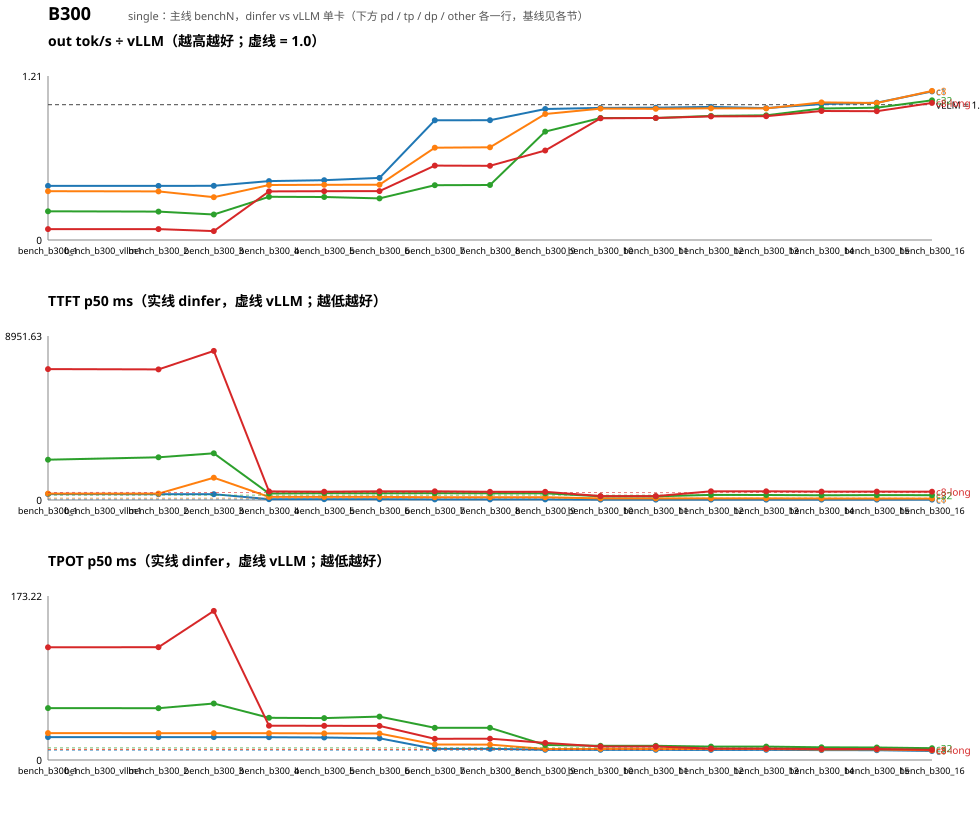

# Qwen3-0.6B 性能趋势（dinfer vs vLLM v0.31.0，`bench_compare.sh` 四组；按卡型分节：B300 / 3090）

每轮一行；括号内是相对上一轮的变化（吞吐 ↑ 为好，TTFT/TPOT ↓ 为好）。比值 = dinfer out tok/s ÷ vLLM（无 vLLM 基线的卡为 —）。vLLM 各轮自己也有 ±3% 抖动。

# B300

## single

基线 = vLLM v0.31.0 单卡（同机同配置）。

| 轮 | 日期 | 改动 | c1 tok/s (×vLLM) | c8 tok/s (×vLLM) | c32 tok/s (×vLLM) | c8-long tok/s (×vLLM) | c1 TTFT ms | c8 TTFT ms | c32 TTFT ms | c8-long TTFT ms | c1 TPOT ms | c8 TPOT ms | c32 TPOT ms | c8-long TPOT ms |
|---|---|---|---|---|---|---|---|---|---|---|---|---|---|---|
| bench_b300_1 | 2026-10-19 | 里程碑 5 首轮：真权重 e2e 通过（ctx 绑定 + zero-centered RMSNorm 修复），eager 单流无 CUDA graph | 38 (0.40×) | 242 (0.36×) | 454 (0.21×) | 45 (0.08×) | 322.8 / 47.3 | 349.2 / 101.1 | 2200.1 / 263.7 | 7147.3 / 407.7 | 24.14 / 10.30 | 28.39 / 11.20 | 54.83 / 12.91 | 118.98 / 11.24 |
| bench_b300_vllm1 | 2026-10-19 | Qwen3.5-27B bf16 vLLM nightly 单卡基线（B300-50 GPU 7，/data/models/Qwen/Qwen3.8-27B，dinfer 侧未实现） | — (—×) (—) | — (—×) (—) | — (—×) (—) | — (—×) (—) | — / 44.8 (—) | — / 98.8 (—) | — / 263.5 (—) | — / 412.6 (—) | — / 10.24 (—) | — / 11.15 (—) | — / 12.87 (—) | — / 11.20 (—) |
| bench_b300_2 | 2026-10-19 | GDN slot 在请求结束时归还（修 c8-long 下活请求 slot 被淘汰）；其余同 bench_b300_1 | 38 (0.40×) (—) | 242 (0.36×) (—) | 452 (0.21×) (—) | 45 (0.08×) (—) | 318.9 / 46.2 (—) | 349.0 / 99.7 (—) | 2331.6 / 265.2 (—) | 7130.7 / 409.7 (—) | 24.14 / 10.30 (—) | 28.31 / 11.20 (—) | 54.74 / 12.90 (—) | 119.17 / 11.24 (—) |
| bench_b300_3 | 2026-10-19 | 强制关 prefix caching（GDN 状态不可按块复用）；slot 归还 | 38 (0.40×) (+0%) | 213 (0.32×) (-12%) | 406 (0.19×) (-10%) | 37 (0.07×) (-18%) | 319.1 / 46.4 (-0%) | 1218.0 / 101.6 (-249%) | 2547.2 / 260.4 (-9%) | 8137.8 / 408.1 (-14%) | 24.13 / 10.30 (+0%) | 28.32 / 11.20 (-0%) | 59.69 / 12.91 (-9%) | 157.47 / 11.24 (-32%) |
| bench_b300_4 | 2026-10-19 | GDN chunk prefill kernel（prep/wy/ho 三段 fp32，BT=64）替代逐 token 顺序递归 | 41 (0.44×) (+9%) | 273 (0.41×) (+28%) | 680 (0.32×) (+68%) | 200 (0.36×) (+445%) | 44.8 / 46.1 (+86%) | 168.8 / 104.9 (+86%) | 356.6 / 261.2 (+86%) | 469.6 / 403.4 (+94%) | 24.13 / 10.30 (+0%) | 28.26 / 11.19 (+0%) | 44.52 / 12.91 (+25%) | 36.26 / 11.24 (+77%) |
| bench_b300_5 | 2026-10-19 | decode CUDA graph（bucket 懒捕获，GRAPH_CAPTURE=eager 启动全捕获）+ GDN fused gate + 独立非默认流 | 42 (0.44×) (+2%) | 274 (0.41×) (+1%) | 683 (0.32×) (+0%) | 201 (0.36×) (+0%) | 45.4 / 46.2 (-1%) | 168.1 / 99.6 (+0%) | 368.8 / 261.4 (-3%) | 455.5 / 411.0 (+3%) | 23.76 / 10.30 (+2%) | 28.06 / 11.20 (+1%) | 44.22 / 12.91 (+1%) | 36.08 / 11.24 (+1%) |
| bench_b300_6 | 2026-10-19 | decode 小 M GEMM：cuBLASLt algo 启动自调优 + 自写 gemm_small_m split-K 取优（ArchProfile）+ GDN recurrent vsplit | 43 (0.46×) (+4%) | 275 (0.41×) (+0%) | 661 (0.31×) (-3%) | 201 (0.36×) (+0%) | 45.3 / 46.6 (+0%) | 168.6 / 102.0 (-0%) | 366.4 / 261.1 (+1%) | 472.2 / 408.3 (-4%) | 22.89 / 10.30 (+4%) | 28.01 / 11.19 (+0%) | 45.81 / 12.90 (-4%) | 36.02 / 11.24 (+0%) |
| bench_b300_7 | 2026-10-19 | GDN / 全注意力 7 处 GEMM 改 forward_rows（之前 decode 每步按 max_tokens=2112 行算） | 84 (0.88×) (+93%) | 459 (0.68×) (+67%) | 872 (0.41×) (+32%) | 307 (0.55×) (+52%) | 35.3 / 46.0 (+22%) | 152.4 / 98.9 (+10%) | 368.8 / 262.4 (-1%) | 472.9 / 405.9 (-0%) | 11.77 / 10.30 (+49%) | 16.36 / 11.20 (+42%) | 34.05 / 12.91 (+26%) | 22.42 / 11.24 (+38%) |
| bench_b300_8 | 2026-10-19 | GDN decode 递归 kernel 重写：寄存器驻留 warp kernel，grid (B, HV, V/BV)，BV 由 ArchProfile 给 | 83 (0.89×) (-0%) | 460 (0.69×) (+0%) | 873 (0.41×) (+0%) | 306 (0.55×) (-0%) | 35.3 / 48.0 (-0%) | 153.5 / 103.2 (-1%) | 365.6 / 265.2 (+1%) | 449.6 / 405.8 (+5%) | 11.79 / 10.30 (-0%) | 16.30 / 11.19 (+0%) | 34.03 / 12.90 (+0%) | 22.47 / 11.25 (-0%) |
| bench_b300_9 | 2026-10-19 | gdn_recurrent 显式 tokens → decode 真正走寄存器 kernel（第 4 轮生效） | 91 (0.97×) (+10%) | 626 (0.93×) (+36%) | 1718 (0.80×) (+97%) | 368 (0.66×) (+20%) | 35.2 / 47.8 (+0%) | 152.9 / 99.0 (+0%) | 367.3 / 265.2 (-0%) | 447.5 / 409.5 (+0%) | 10.74 / 10.30 (+9%) | 11.65 / 11.20 (+29%) | 15.89 / 12.91 (+53%) | 18.02 / 11.25 (+20%) |
| bench_b300_10 | 2026-10-19 | GEMM 自调优表展开非幂 M（借桶 + AlgoCheck）+ 默认 algo 缓存（之前每次 forward 查启发式） | 92 (0.98×) (+1%) | 652 (0.97×) (+4%) | 1938 (0.90×) (+13%) | 501 (0.90×) (+36%) | 22.1 / 47.0 (+37%) | 85.9 / 104.2 (+44%) | 201.7 / 263.7 (+45%) | 214.2 / 411.3 (+52%) | 10.74 / 10.29 (-0%) | 11.68 / 11.20 (-0%) | 15.05 / 12.91 (+5%) | 14.27 / 11.24 (+21%) |
| bench_b300_11 | 2026-10-19 | GDN prefill 三段 mma 化：ho/wy 走 mma.sync bf16，conv1d prefill 按 T 分块（ArchProfile 选 BV / rows） | 92 (0.98×) (+0%) | 652 (0.97×) (+0%) | 1937 (0.90×) (-0%) | 502 (0.90×) (+0%) | 22.4 / 47.3 (-1%) | 87.4 / 99.4 (-2%) | 200.1 / 263.2 (+1%) | 212.1 / 406.0 (+1%) | 10.73 / 10.29 (+0%) | 11.66 / 11.20 (+0%) | 15.03 / 12.91 (+0%) | 14.26 / 11.24 (+0%) |
| bench_b300_12 | 2026-10-19 | 调度预算 max_num_batched_tokens 2048 → 16384（与 vLLM 容器一致）；代码同 bench_b300_11 | 93 (0.98×) (+1%) | 654 (0.97×) (+0%) | 1970 (0.92×) (+2%) | 510 (0.91×) (+1%) | 22.5 / 47.8 (-0%) | 84.7 / 100.3 (+3%) | 276.4 / 265.0 (-38%) | 474.9 / 406.3 (-124%) | 10.67 / 10.29 (+1%) | 11.64 / 11.19 (+0%) | 14.20 / 12.90 (+6%) | 12.07 / 11.24 (+15%) |
| bench_b300_13 | 2026-10-19 | 激活缓冲全模型共享一套（ActScratch，170 GB → 2.8 GB）；预算 16384 | 92 (0.97×) (-1%) | 654 (0.97×) (-0%) | 1980 (0.92×) (+1%) | 510 (0.91×) (+0%) | 22.1 / 46.5 (+2%) | 84.6 / 101.0 (+0%) | 274.7 / 264.1 (+1%) | 474.0 / 407.6 (+0%) | 10.76 / 10.30 (-1%) | 11.64 / 11.19 (-0%) | 14.12 / 12.90 (+1%) | 12.07 / 11.24 (-0%) |
| bench_b300_14 | 2026-10-19 | 第 7 轮：GDN decode kernel tr 变体 + bv32、rmsnorm block1024、gated_rmsnorm warp（B300 实测定默认） | 95 (1.00×) (+3%) | 682 (1.02×) (+4%) | 2087 (0.97×) (+5%) | 531 (0.95×) (+4%) | 21.4 / 47.4 (+3%) | 81.9 / 106.7 (+3%) | 258.2 / 263.0 (+6%) | 456.8 / 412.8 (+4%) | 10.45 / 10.29 (+3%) | 11.14 / 11.19 (+4%) | 13.41 / 12.90 (+5%) | 11.59 / 11.24 (+4%) |
| bench_b300_15 | 2026-10-19 | 第 8 轮：executor 公共件（dinfer_layers::exec）+ qwen35 接 async scheduling（两槽 pinned D2H 流水） | 96 (1.01×) (+1%) | 681 (1.01×) (-0%) | 2103 (0.98×) (+1%) | 530 (0.95×) (-0%) | 21.4 / 47.4 (-0%) | 83.5 / 99.9 (-2%) | 266.9 / 262.0 (-3%) | 458.1 / 412.1 (-0%) | 10.34 / 10.29 (+1%) | 11.16 / 11.19 (-0%) | 13.23 / 12.91 (+1%) | 11.60 / 11.25 (-0%) |
| bench_b300_16 | 2026-10-19 | 第 9 轮：GDN in_proj 四合一（N=16480）+ 全注意力 qkv|gate 合一（14336），每步少 160 launch；small_m M_TILE 16/32 入候选 | 104 (1.10×) (+8%) | 741 (1.10×) (+9%) | 2218 (1.03×) (+5%) | 565 (1.01×) (+7%) | 19.9 / 47.3 (+7%) | 78.9 / 102.1 (+5%) | 260.9 / 267.4 (+2%) | 454.2 / 405.8 (+1%) | 9.55 / 10.29 (+8%) | 10.23 / 11.20 (+8%) | 12.47 / 12.90 (+6%) | 10.67 / 11.24 (+8%) |
| bench_b300_17 | 2026-10-20 | 第 10 轮：r8 GDN 状态按块缓存（prefix cache 重开）+ r9 GDN chunk 三段（wy 分块逆 / ho 装载重写 / 按卡分档）+ thread_local 修复 + 装载骨架公共件 | 102 (1.09×) (-1%) | 743 (1.11×) (+0%) | 2241 (1.05×) (+1%) | 570 (1.02×) (+1%) | 17.6 / 46.4 (+12%) | 72.8 / 97.7 (+8%) | 242.4 / 265.1 (+7%) | 434.4 / 404.0 (+4%) | 9.70 / 10.36 (-2%) | 10.26 / 11.20 (-0%) | 12.47 / 12.92 (-0%) | 10.71 / 11.25 (-0%) |
| bench_b300_18 | 2026-10-20 | 第 11 轮：r8b（kernel 沿 chunk 边界写 GDN 快照，调度不切步）+ r10 第 1–4 轮（中间量 bf16 / Sm100 ho 预取 / wy 8 warp / 向量装载）合体 | 102 (1.09×) (-0%) | 744 (1.11×) (+0%) | 2250 (1.05×) (+0%) | 577 (1.03×) (+1%) | 16.6 / 46.7 (+5%) | 70.4 / 98.3 (+3%) | 160.5 / 261.5 (+34%) | 413.3 / 403.8 (+5%) | 9.73 / 10.36 (-0%) | 10.27 / 11.20 (-0%) | 13.05 / 12.92 (-5%) | 10.72 / 11.25 (-0%) |
| bench_b300_19 | 2026-10-20 | 第 12 轮：r10 收口（8 轮，ArchProfile Sm100 ho BV 按形状 64/32、wy 全卡 8 warp、ho 预取开；8×1024 kernel 1109→770）+ r8b 不切步 合体定稿 | 103 (1.09×) (+0%) | 743 (1.11×) (-0%) | 2228 (1.04×) (-1%) | 578 (1.04×) (+0%) | 16.9 / 47.0 (-2%) | 70.6 / 97.5 (-0%) | 167.9 / 260.9 (-5%) | 409.5 / 405.2 (+1%) | 9.68 / 10.36 (+0%) | 10.27 / 11.20 (+0%) | 13.08 / 12.91 (-0%) | 10.71 / 11.25 (+0%) |
| bench_b300_20 | 2026-10-20 | r11b 第 4 轮：GemmPlan::SmallMma 进自调优候选（B300 全部仍选 lt，路径不变；回归门禁） | 103 (1.09×) (+0%) | 744 (1.11×) (+0%) | 2251 (1.05×) (+1%) | 579 (1.04×) (+0%) | 16.6 / 44.7 (+1%) | 69.8 / 97.0 (+1%) | 234.1 / 259.5 (-39%) | 409.0 / 408.0 (+0%) | 9.65 / 10.36 (+0%) | 10.26 / 11.20 (+0%) | 12.47 / 12.92 (+5%) | 10.71 / 11.25 (+0%) |
| bench_merge_21 | 2026-10-21 | r11 合并：r11a gqa v6(cfg 3464) + r11b small_m_mma 候选（B300 仍选 lt） | 103 (1.10×) (+0%) | 743 (1.10×) (-0%) | 2257 (1.05×) (+0%) | 578 (1.04×) (-0%) | 16.9 / 44.9 (-1%) | 69.5 / 96.4 (+0%) | 235.0 / 258.4 (-0%) | 408.2 / 402.2 (+0%) | 9.60 / 10.36 (+0%) | 10.28 / 11.20 (-0%) | 12.43 / 12.92 (+0%) | 10.72 / 11.25 (-0%) |

### 首轮 → 最新

| 组 | out tok/s | ×vLLM | TTFT ms | TPOT ms |
|---|---|---|---|---|
| c1 | 38 → 103 (+174%) | 0.40 → 1.10 | 322.8 → 16.9 (+95%) | 24.14 → 9.60 (+60%) |
| c8 | 242 → 743 (+207%) | 0.36 → 1.10 | 349.2 → 69.5 (+80%) | 28.39 → 10.28 (+64%) |
| c32 | 454 → 2257 (+397%) | 0.21 → 1.05 | 2200.1 → 235.0 (+89%) | 54.83 → 12.43 (+77%) |
| c8-long | 45 → 578 (+1184%) | 0.08 → 1.04 | 7147.3 → 408.2 (+94%) | 118.98 → 10.72 (+91%) |

# 3090

## single

（本卡暂无主线 benchN 轮次）

